# mitate（見立て）

帳票の手書きを読む、軽い日本語OCR。Oxi の様式（.docx）から読み取りの定義を作り、読んだ値を元の様式に戻す。
「見立て」= 見たものから根拠をもって判断すること。答えごとに、画像で読めたのか・知識で補ったのか（画像 / 推定 / 推測）を返す。

**目標:** 商用で使えて、安くて軽い日本語OCR。帳票の手書きを、人と同じ感覚で読む。

**範囲:** 帳票特化。Word / Excel で作られた帳票（.docx が欄の定義）と、その手書き欄を読む。
レイアウト解析・表の構造推定・段組みのような「何でも読む」汎用 OCR は、当面やらない。
特徴は、軽さ（認識器 25MB、CPU で帳票 1 枚 20 行を 1.0〜2.1 秒）、最初から商用で使えるライセンス、
能力を数字で公開すること（下の「読める / ぎりぎり / 読めない」）、答えの出どころ（画像 / 推定 / 推測）を返すこと。

## 方針

| 項目 | 決めたこと | 理由 |
|---|---|---|
| 方式 | 検出 → 行ごとの認識（CTC） | VLM は重く、もっともらしい補完をする。帳票の数字・氏名は「形で読む」ほうが安全 |
| 大きさ | 認識器 約 6.3M パラメータ（25MB） | CPU・ブラウザ（ONNX）で動かす |
| 学習データ | すべて自前の合成。他の OCR の出力は一切使わない | ライセンスをきれいに保つ |
| 帳票の描画 | **Oxi** で .docx → PDF → 画像 + 文字位置 | Word と同じレイアウト・罫線・詰め書き（`w:w`, `w:spacing`）を正解つきで量産できる |
| 手書き | KanjiVG の筆画から「架空の書き手」のフォントを大量生成 | 商用で使える日本語手書きデータセットがほぼ無いため |

## 構成

```
mitate/charset.py    文字集合（cp932 = JIS X 0208 + NEC/IBM拡張、7,326 字）と正規化
mitate/textgen.py    学習用の文字列（氏名・住所・日付・金額などの記入欄 + 擬似日本語 + 一様サンプル）
mitate/hwfont.py     手書きフォント生成（1 フォント = 1 人の書き手。癖のパラメータは writers.jsonl）
mitate/render.py     1 行の描画と劣化（スキャン・FAX・撮影、詰め書き、縦書き、罫線またぎ）
mitate/oxiforms.py   帳票 .docx の生成 → Oxi で PDF → 行の切り出し
mitate/oxigen.py     Oxi 帳票の行データを大量に書き出す
mitate/data.py       学習データ（合成の行 + Oxi の行）
mitate/model.py      CRNN（CNN + BiLSTM + CTC）
mitate/train.py      学習と評価
mitate/infer.py      読み取り（Reader、縦書き、段階的に使う Cascade）
mitate/fields.py     欄の知識（欄の種類で文字を絞る・候補を画像で比べる・答えの出どころ）
mitate/lexicon.py    会社名・住所の語彙（市区町村名は日本郵便の郵便番号データから）
mitate/formread.py   帳票の写真を読んで、元の .docx に戻す
mitate/gallery.py    「読める / ぎりぎり / 読めない」の表
mitate/fieldeval.py, formtest.py, humantest.py, boundary.py   評価
tools/formfill.mjs   Oxi（wasm）で欄の位置・空欄の様式・差し込み
```

## すぐ試す

```bash
uv sync
python -m mitate.lexicon download        # 郵便番号データ（住所の語彙。なくても動く）
python -m mitate.formread read 様式.docx 写真.jpg --out out/
```

```python
from mitate.infer import Reader
reader = Reader()                            # 学習済みモデル（初回だけ取得、~/.cache/mitate）
reader.read([行の画像])                      # 横書き
reader.read([行の画像], vertical=True)       # 縦書き
```

## 学習済みモデル

| | |
|---|---|
| ファイル | `mitate-v0.1.pt`（GitHub Releases の v0.1.0、25MB、重みだけ・`torch.load(weights_only=True)` で読める） |
| 中身 | CRNN（CNN + BiLSTM + CTC）、6.3M パラメータ、横の細かさ 2px、文字集合 cp932（7,326 字） |
| 読めるもの | 活字と手書きの 1 行（横書き・縦書き）。帳票の記入欄（氏名・住所・日付・金額・電話番号・郵便番号など）向け |
| 学習データ | すべて合成。活字フォント（OFL / IPA）と、KanjiVG の筆画から作った架空の書き手の手書きフォント、Oxi で描いた帳票 |
| 能力 | 下の「読める / ぎりぎり / 読めない」と「欄の知識の使い方」の表（学習に使っていない書体・書き手で測ったもの） |
| 注意 | 本物の手書きでは確かめていない（合成の手書きだけで学習・評価している） |
| ライセンス | MIT または Apache-2.0（コードと同じ） |

## 必要なもの（学習するとき・リポジトリに入っていないもの）

- **手書きフォント**: `python -m mitate.hwfont` で KanjiVG から生成する（KanjiVG は https://github.com/KanjiVG/kanjivg から取得し `third_party/` に置く）
- **活字フォント**: BIZ UD・IPA・Noto Sans JP・Zen・M PLUS など（OFL / IPA フォントライセンス）。`~/.local/share/fonts/` に置く
- **Oxi**: CLI（`oxi docx-to-pdf`、`tools/oxi/oxi`）と wasm（`docx_field_boxes` を含む版、`tools/oxi-wasm/`）
- **oxi-forms**: 差し込み（`lib/oxi-fill.js`）。既定は `~/oxi-forms`、環境変数 `OXI_FORMS` で変えられる
- **郵便番号データ**: 日本郵便の KEN_ALL.CSV を `data/dict/ken_all/` に置く

## 使い方

```bash
uv sync
python -m mitate.hwfont --n 300 --out fonts/hw --workers 12        # 手書きフォント（1 個 約1分/コア）
python -m mitate.oxigen --n 2000 --out data/oxi_lines --workers 4   # Oxi 帳票の行データ
python -m mitate.train --profile full --stride 2 --p_vert 0.3 --out runs/s2cam
```

生成した手書きフォントは `tools/oxi/fonts/` に置き、システムのフォントには入れない。

## 読める / ぎりぎり / 読めない

このOCRに任せてよい範囲。条件を 1 つずつ悪くしていき、どこで読めなくなるかを測ったもの
（`python -m mitate.gallery <チェックポイント>` で再生成）。

<!-- readability:start -->
判定は各段階 50 行（学習に使っていない書体・書き手、帳票の記入欄らしい言葉: 名前・住所・日付・金額・電話番号など、スペースは無視）の行の正解率で、**読める** = 90% 以上、**ぎりぎり** = 50〜90%、**読めない** = 50% 未満。見本は「山田太郎 令和7年4月1日 ¥12,345」を 手書きで描いたもの。モデル: `runs/s2cam/last.pt`

| 条件 | 読める | ぎりぎり | 読めない |
|---|---|---|---|
| 解像度（字の高さ (px)） | 32, 20, 14, 11 | 9 | 7 |
| ぼけ（σ (px, 字の高さ 40px 換算)） | 0, 1, 1.5, 2, 3 | 4 | — |
| 薄さ（紙とインクの濃淡差） | 200, 120, 80, 50, 35, 20 | — | — |
| ノイズ（σ） | 0, 10, 20, 35, 50, 70 | — | — |
| JPEG 圧縮（品質） | 95, 50, 25, 12, 6 | 3 | — |
| 傾き（度（行ごと。切り出しは傾いた行を囲む長方形）） | 0, 1, 2, 3, 5, 8 | — | — |
| 影（暗くなる割合（境目が行を横切る）） | 0, 0.2, 0.35, 0.5, 0.65, 0.8 | — | — |
| 照明のむら（端の暗くなる割合） | 0, 0.3, 0.5, 0.7, 0.8, 0.9 | — | — |
| 手ぶれ（ぶれの長さ (px, 字の高さ 40px 換算)） | 0, 2, 4, 6, 8, 12 | — | — |
| 急ぎ（急ぎ度（学習は 0〜1）） | 0, 0.3, 0.6, 1, 1.5 | 2 | — |
| 疲れ（疲れ度（学習は 0〜1）） | 0, 0.3, 0.6, 1, 1.5, 2 | — | — |

#### 解像度

32: 100% / 20: 100% / 14: 96% / 11: 92% / 9: 84% / 7: 38%

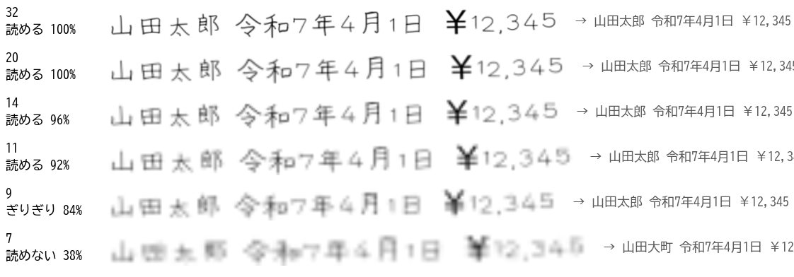

#### ぼけ

0: 98% / 1: 100% / 1.5: 98% / 2: 98% / 3: 92% / 4: 86%

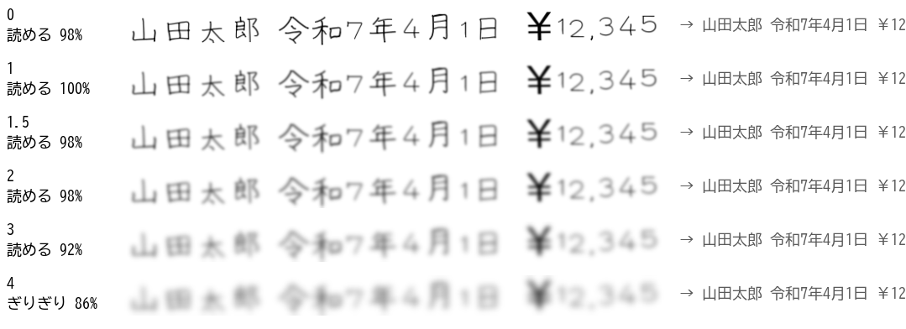

#### 薄さ

200: 100% / 120: 98% / 80: 98% / 50: 98% / 35: 98% / 20: 94%

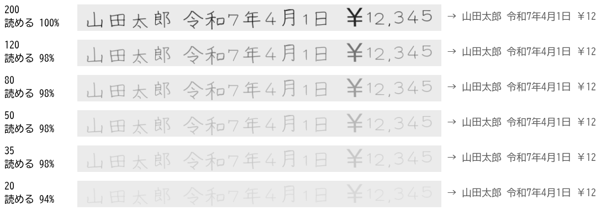

#### ノイズ

0: 98% / 10: 100% / 20: 100% / 35: 100% / 50: 100% / 70: 94%

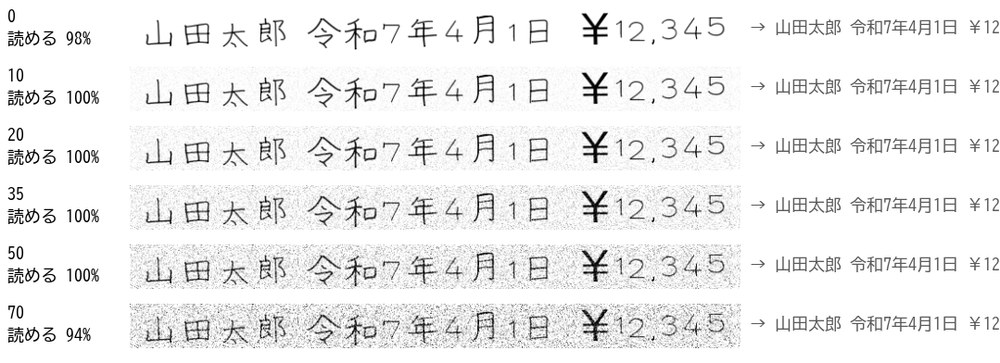

#### JPEG 圧縮

95: 98% / 50: 98% / 25: 100% / 12: 100% / 6: 98% / 3: 86%

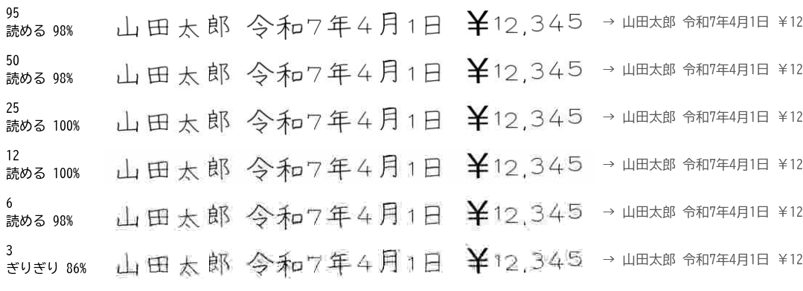

#### 傾き

0: 100% / 1: 100% / 2: 100% / 3: 100% / 5: 98% / 8: 90%

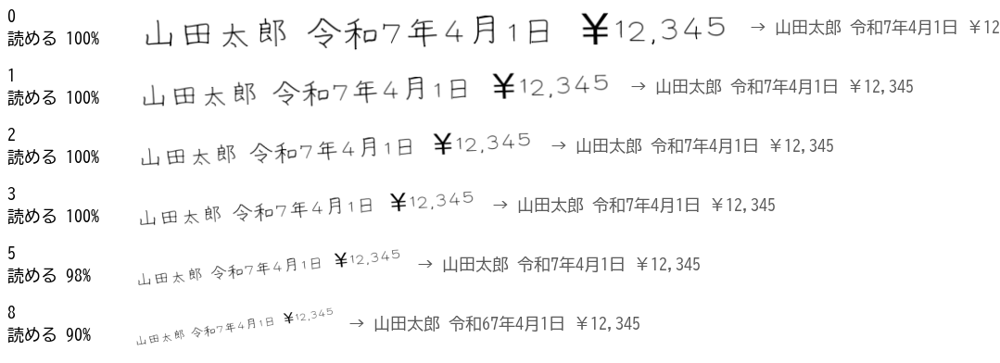

#### 影

0: 98% / 0.2: 100% / 0.35: 100% / 0.5: 100% / 0.65: 100% / 0.8: 98%

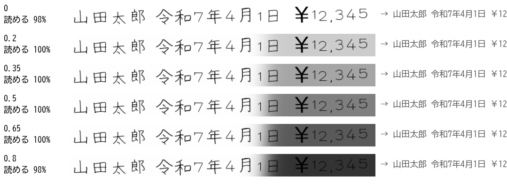

#### 照明のむら

0: 98% / 0.3: 98% / 0.5: 98% / 0.7: 98% / 0.8: 98% / 0.9: 98%

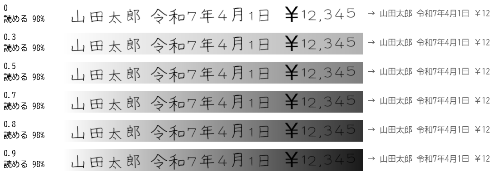

#### 手ぶれ

0: 98% / 2: 98% / 4: 98% / 6: 98% / 8: 98% / 12: 90%

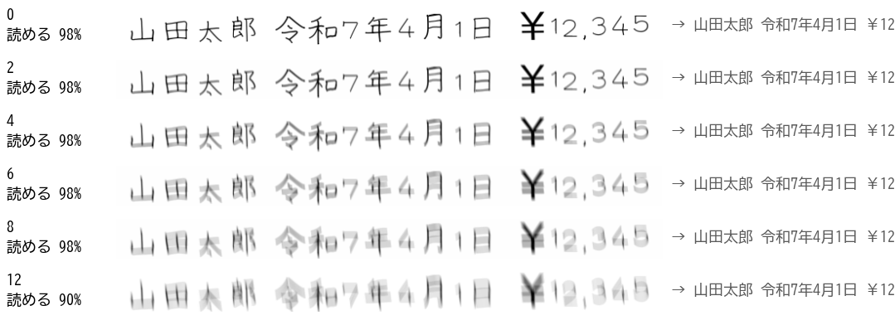

#### 急ぎ

0: 100% / 0.3: 100% / 0.6: 98% / 1: 98% / 1.5: 96% / 2: 80%

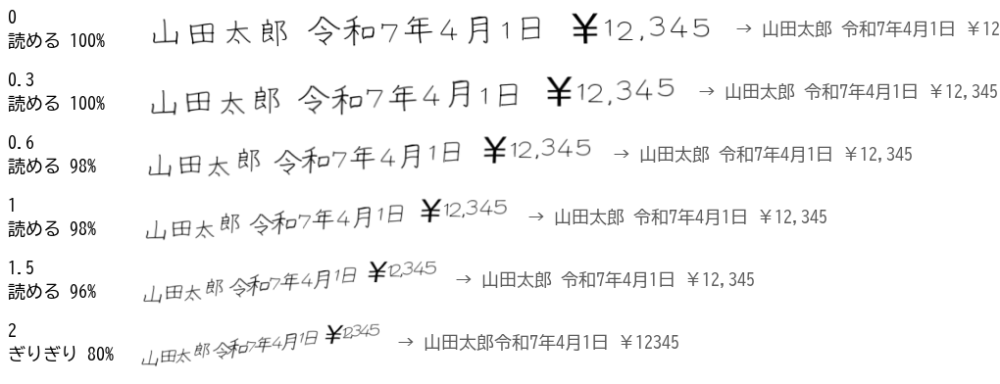

#### 疲れ

0: 100% / 0.3: 98% / 0.6: 96% / 1: 98% / 1.5: 96% / 2: 98%

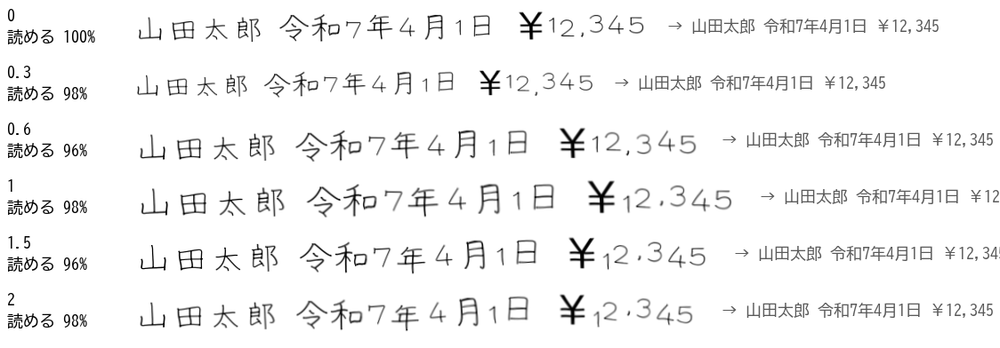

<!-- readability:end -->

## 目指すもの: 人と同じ感覚

人より優れる必要はない。**人と同じところで迷い、人と同じところで自信を持つ**ほうが受け入れられる。
信頼を壊すのは誤りの数より種類で、「人でも間違える誤り」は許されるが、「人なら絶対にしない誤り」
（はっきり書いた「令和」を「会和」、電話番号に「I」）は一度で信用を失う。

| 指標 | 目標 |
|---|---|
| 人なら間違えない誤り（人が全員正しく読めた画像での誤り率） | 0 に近づける（最優先） |
| 迷う場所の一致（人が迷う画像で確信度が下がるか） | 人の難しさと確信度がそろう |
| 迷い方の伝え方 | 「3 か 8 で迷いました」のように候補を見せる |

そのために、見本画像を人に読んでもらい、人の境目とモデルの境目を比べる。

## 欄の知識の使い方（`mitate/fields.py`）

人は崩れた字でも「名前の欄なら山田太郎だろう」と知識を掛け合わせて読む。これを取り入れるが、
**辞書は候補を出すだけ、決めるのは画像**。どこから答えが来たかを分けて返す。

| 判定 | 意味 | 扱い |
|---|---|---|
| 画像 | 画像だけで決まった | 自動で受け付け |
| 画像＋知識 | 画像では迷ったが、欄の知識（辞書・元号・日付の妥当性）で絞れた | 「推定」として人が確認 |
| 判断できない | 誤りは分かるが、正解は知識では決められない | 受け付けない |

知識の強さは欄ごとに変える。元号は 4 つしかないので強く、名前は弱く（珍しい名前や 髙/高・﨑/崎 の
ような異体字を「よくある字」に直さないため）。数字の並びのきれいさ（「12?45 なら 3」）は使わない
（実際の電話番号や金額はでたらめな並びなので、12,845 を 12,345 に直してしまう）。

- **欄の種類で文字を絞る**: 電話番号の欄なら数字とハイフンだけから選ぶ。値は推測せず、文字の種類だけ絞る
- **しっかり読めたら画像を採用**: 辞書にない名前も珍しい名前として通す。ありえない内容（2 月 30 日）は
  OCR の誤りでなく記入ミスの可能性として、書かれたとおりに残して印を付ける
- **会社名・住所の語彙**（`mitate/lexicon.py`）: 語彙の言葉と 1〜2 字だけ違う部分を言葉に置き換えた候補を作り、
  画像で比べる。言葉の強さは 2 段階: 法人の種類（株式会社…）と都道府県は強く、業種の言葉（不動産・製作所…）と
  市区町村名（日本郵便の郵便番号データから）は中くらい。会社の固有の名前・町名・番地には知識を持たない（画像のまま）。
  都道府県と市区町村の組み合わせが実在しないときは、直さずに「記入内容の確認が必要」の印を付ける
- **効き目**（`python -m mitate.fieldeval runs/s2cam/last.pt`、学習に使っていない書き手 910・911）:

  | | 画像だけ | 欄の知識あり | 直った | 壊した |
  |---|---|---|---|---|
  | 読み取りテストの 78 問 | 61 | **66** | 5 | 0 |
  | 罠 40 問（語彙にない名前「後藤組」「桜井保守」や、実在の町名） | 21 | 22 | 1 | **0** |
  | 詰め書きの数字 42 問（11・00・細い 1 が続く金額・番地・郵便番号） | **32**（stride 4 のモデルは 16） | 32 | 0 | 0 |

  詰め書きで残る 10 問は「〒111-1111」「1-11-11」「〒011-0110」のように 1 や 0 が続くもので、どれも
  「自信低め」「記入内容の確認が必要」「推測」の印が付く（印なしで通る間違いは 0）。金額は全問正解
  強さ（中 = 6）は、罠を 1 つも壊さない範囲で決めた。問題の語彙と知識の語彙は別に作っているが、
  「不動産」「病院」のようなありふれた業種の言葉は両方に入っている
- **これから**: 欄同士の計算（合計＝小計＋税）やチェックディジット（マイナンバー・法人番号）で、
  読めない数字を推測ではなく計算で決める郵便番号と住所、氏名とフリガナのような欄同士の突き合わせは、
推測に頼らずに誤りを見つけられるので特に強い。

## 帳票を読んで、元の .docx に戻す（`mitate/formread.py`）

oxi-forms の様式（`{{欄名}}` 入りの .docx）がそのまま「読み取りの定義」になる。

```bash
python -m mitate.formread read 様式.docx 写真.jpg --choices choices.json --out out/
#   out/result.json  欄ごとの値・答えの出どころ・確信度
#   out/filled.docx  読んだ値を差し込んだ元の様式（確かめてほしい欄に色）
#   out/filled.pdf   その PDF（Oxi）
#   out/check.png    写真を様式に重ねて、欄の枠と読みを描いたもの
python -m mitate.formread test 様式.docx --n 30 --out runs/formread   # 合成の記入済み写真で試す
```

1. Oxi（wasm、`tools/formfill.mjs`）の `docx_field_boxes` で各欄の位置、空欄の様式の画像を作る
2. 写真を空欄の様式に重ねる（SIFT の対応点 → 射影変換）。机の上・斜め・遠近のゆがみはここで消える
3. 欄の中の字のある行を切り出す（様式の罫線・印刷の字は除く。閾値は欄ごとの紙のざらつきから決める）
4. 欄の名前から種類を決めて読む（フリガナ・郵便番号・電話番号・住所・日付・金額…、`:和暦` は日付）。
   選択式の欄は `--choices` で選択肢を渡すと、その中から画像に合うものを選ぶ
5. oxi-forms の `lib/oxi-fill.js` で元の様式に差し込む。色: 黄 = 画像だが自信低め・記入内容の確認が必要、
   水色 = 推定（画像＋知識）、桃色 = 推測（要確認）。表の欄はセルの網掛け（Oxi の PDF にも出る）、
   表の外の差し込みは蛍光ペン（Word では見えるが、今の Oxi の PDF には出ない）

合成の記入済み写真 30 枚（`samples/申請書.docx`、学習に使っていない書き手、机の上・斜め ±6°・遠近・影・照明のむら・
ぼけ・JPEG）: **欄の正解 278/300**、色付き 74 欄（うち間違い 20）、**色なしで間違い 2**（「ピョ→ピヌ」、
詰め書きの「11月→1月」）、重ねられなかった写真 0、1 枚 0.7 秒（CPU）。
合成の紙は手書きフォントを貼っただけなので、本物の記入済み用紙での確認が必要。

## モデルを選ぶ

守備範囲（どこまで汚い字を読むか）と大きさを選べる。範囲を狭めたモデルは小さく速くでき、
範囲外の字は「自信なし」として人に回せる。各モデルの「読める / ぎりぎり / 読めない」の表を見て選ぶ。

| 守備範囲 `--profile` | 内容 |
|---|---|
| `print` | 活字だけ |
| `form` | 帳票: 活字 + 丁寧〜普通の手書き（雑な書き手・強い急ぎ/疲れは含めない） |
| `full` | 雑な手書きまで |

| 大きさ `--scale` | パラメータ |
|---|---|
| 0.5（極小） | 2.0M |
| 0.75（小） | 3.9M |
| 1.0（標準） | 6.3M |

| 横の細かさ `--stride` | 内容 |
|---|---|
| 2（標準、`runs/s2cam`） | 2 px ごとに字を判断。詰め書きで同じ数字が続いても潰れない。CPU で 4 の 1.5〜2 倍の時間 |
| 4 | 4 px ごと。速いが、詰め書きの「11」「00」が 1 字に潰れる（詰め書きの数字 42 問中 16 問） |

段階的に使う（`mitate.infer.Cascade`）: 軽いモデルで読み、自信がない行だけ重いモデルへ、
それでも自信がなければ人の確認へ回す。ほとんどの行は軽いモデルで済む。

```bash
python -m mitate.train --profile form --scale 0.5 --out runs/form_s0.5
```

## 評価の分け方

学習に使わない書体・書き手を最初から取り分けて、「初めて見る字」を読めるかで測る。

- 活字（未知の書体）: Zen Old Mincho, M PLUS 1p, Zen Maru Gothic, Yusei Magic
- 手書き（未知の書き手）: HW Synth 0270〜0299

合成データだけの評価は甘くなるので、実物の帳票（実際に記入してもらったもの）での評価セットを別に作る。

## この先

1. **検出器**: Oxi の文字位置から、行の検出器（DBNet 系の軽量版）を学習する
2. **書き手適応**: 同じ用紙の字は同じ人が書いている。確信度の高い字から書き手の特徴ベクトルを取り、
   認識器を調整する。合成フォントは 1 フォント = 1 人なので、書き手 ID のラベルがタダで手に入る。
   ただし文脈で推測させない（勝手に補完しない）方針は守る
3. **はみ出し**: 欄の外まで続く記入、上下への書き足しを、Oxi のテキストボックスで描く
4. **本物の手書き**: 「自分フォント」などで同意を取って集める。ETL 文字データベースは商用利用の可否を産総研に問い合わせる
5. **軽量化**: ONNX 書き出し、int8 量子化、ブラウザで動かす
6. **読んだ結果を元の帳票に戻す**: Word は試作済み（下の「帳票を読んで、元の .docx に戻す」）。
   残りは Excel（oxi-forms の `oxi-fill-xlsx.js`）、複数ページ、帳票 ID の QR コード（どの様式の何版かを一発で決める）
7. **縦書き**: 読める（`Reader.read(images, vertical=True)`）。縦に積んだ行を左に 90° 倒して横書きと同じモデルで読む。
   学習では「ー」やかっこを回し、小さい「ゃ」・句読点を右上に寄せ、2 桁の数字はときどき縦中横にしている。
   未学習の書体で行の正解率 86%（文字誤り 1.9%）、未学習の書き手で 73%（5.4%）。横書きよりまだ弱い。
   Oxi はまだ縦書き（`w:textDirection`）を描けないので、学習データは自前の描画（`render.draw_vertical`）だけ
8. **撮影の条件**: 傾き・影・照明のむら・手ぶれは表に足して学習にも入れた（`render.tilt / shadow / uneven_light / motion_blur`）。
   残りは遠近のゆがみ（斜めから撮った紙）。帳票は台紙（.docx）と位置合わせできるので、ページ全体で直してから行を切る
9. **書き手の情報は保存しない**: 書き手の特徴ベクトルは筆跡鑑定に近い生体情報になる。
   その用紙を読む間だけ使い、保存しない（「読むけれど、誰かは覚えない」）

## ライセンス

コード: MIT または Apache-2.0（`LICENSE-MIT`、`LICENSE-APACHE`）。

`docs/readability/` の見本画像の手書きの字は、KanjiVG（© Ulrich Apel、CC BY-SA 3.0、https://kanjivg.tagaini.net/）の
筆画データから生成した字形を含むため、これらの画像は CC BY-SA 3.0 で提供する。

### 使っているデータの扱い

- KanjiVG: CC BY-SA 3.0。生成した手書きフォントは学習専用とし、配布しない（配布すると SA 条件がかかる）
- 活字フォント: OFL / IPA フォントライセンス。学習用の描画に使う
- 郵便番号データ（日本郵便）: 「郵便番号データに限っては日本郵便株式会社は著作権を主張しません。自由に配布していただいて結構です。」
  市区町村名の語彙に使う
- 他の OCR の出力は、学習にも評価にも使わない
